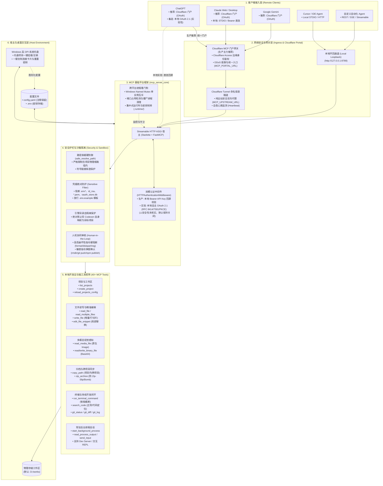

# Codexen 🚀
### Secure MCP Bridge Engine for Remote AI Agents & Local Development
**专为 ChatGPT、Claude、Gemini、Cursor 及各类 AI Agent 连接本地电脑进行工程开发打造的安全 MCP 桥接引擎**

[](https://python.org)
[](https://modelcontextprotocol.io)
[](LICENSE)

---

> 📖 **安装与部署指南**：  
> 本项目的环境初始化、依赖安装、配置文件字典与 AI Agent 自动化部署规范，请参阅 📄 **[DEPLOYMENT.md (完整部署与运维指南)](DEPLOYMENT.md)**。

---

## 📖 项目简介 (Introduction)

**Codexen** 是一个开源的本地 MCP（Model Context Protocol）桥接服务器。它旨在让外部远程 AI Agent（如 **ChatGPT**、**Claude**、**Gemini**、**Cursor** 及私有 Agent）在**无需公网 IP、无需云端服务器、无需复杂第三方认证平台**的前提下，安全、可控地连接至您的个人电脑，完成真正的**本地工程开发闭环**（写代码、批量操作、自测运行单元测试、管理长耗时服务与 Git 审查）。

### 💡 解决的核心痛点

| 传统痛点 | Codexen 解决方案 |
| :--- | :--- |
| **ChatGPT 接入鉴权与公网暴露风险** | **多模式授权体系**：<br/>• **生产主力推荐**：基于 **Cloudflare MCP 门户授权** 与 Cloudflare Access / Tunnel，由成熟的边缘网络提供统一身份鉴权与安全防护，本地仅作为内网节点安全回源。<br/>• **实验备选**：内置轻量级 OAuth 2.1（RFC 8414 / RFC 7591 DCR / PKCE S256），供无域名环境下的本地开发测试（⚠️安全性未核实，默认保持关闭）。 |
| **无公网 IP，外网 Agent 无法连接** | 原生集成 Cloudflare Tunnel，支持绑定永久固定域名或自动拉起自愈型安全穿透隧道。 |
| **远程 Agent 只能盲改，无法测试** | 提供受控终端执行与**异步后台长进程管理**，Agent 改完代码可即时运行 `pytest`、`npm test` 并实时查看日志。 |
| **远程操控的安全失控隐患** | 内置严格路径逃逸防御、敏感凭证绝对黑名单（保护 `.env*`、私钥、密钥）、破坏性指令硬阻断与人机协同（HITL）确认。 |
| **MCP 响应被网关截断丢数据** | 独创 `ToolResultListDict` 单块原子字典封装，完美规避中间 MCP 网关仅解析末尾文本块导致的文件列表截断 Bug。 |

---

## 🏛️ 架构蓝图 (Architecture Blueprint)



---

## ⚡ 核心能力一览 (Features)

### 1. 完整开发闭环：从“只读写”到“可跑测自愈”
外部 Agent 不再处于“盲改代码”状态：
* **实时受控终端**：放行 `git`, `pytest`, `python`, `npm`, `cargo`, `ruff`, `tsc` 等常用套件。
* **智能截断保留**：针对超长构建或测试输出，采用“头部环境上下文 + 尾部致命错误堆栈”最佳实践，单次最高输出 50,000 字符，不撑爆 LLM 上下文。
* **常驻进程管理**：支持由 Agent 启动长期运行的本地开发服务器（如 `npm run dev`, `uvicorn`），并通过会话 ID 增量轮询日志或写入输入。

### 2. 独创原子单块封装 (`ToolResultListDict`)
FastMCP 默认将 Python 列表转化为多个分散的 `TextContent` 块。许多中间网关（包括部分云端 Agent 转发层）只抓取最后一块，导致文件列表只返回最后一个文件。Codexen 独创的 `ToolResultListDict` 在底层兼具字典与列表特性，将完整数据打包为单个 JSON 文本块，彻底消除截断。

### 3. 多模态视觉赋能 (`read_media_file`)
支持直接读取工作区中的 `.png`, `.jpg`, `.jpeg`, `.gif`, `.webp` 图像并打包为原生 FastMCP `Image` 实例。支持视觉能力的现代大模型（GPT-4o, Claude 3.5 Sonnet 等）无需经过 Base64 解码即可直接在聊天框内审查生成的图表、UI 截图或素材。

### 4. 零侵入注释保留热更新
动态新增项目时，底层采用 `ruamel.yaml` 往返引擎，自动保留用户在 `config.yaml` 中编写的所有原始排版与中文注释。

---

## 🛠️ 核心工具矩阵表 (Tool Matrix)

| 分类 | 工具名称 (含主流别名) | 核心功能与亮点 |
| :--- | :--- | :--- |
| **工作区与项目** | `list_projects` | 列出所有已映射与自动发现的工作区项目、物理路径及状态（单块原子封装，防网关截断） |
| | `create_project` | 在统一工作区根目录下创建新工程并立即热挂载 |
| | `get_project_info` | 查询指定项目的物理路径、读写权限与文件元数据 |
| | `reload_projects_config` | 重新读取磁盘配置并刷新映射表，无需重启服务 |
| **文件读写与编辑** | `read_project_file` / `read_file` | 安全读取文件内容，支持行切片（`start_line`/`end_line`）与前导斜杠容错 |
| | `read_multiple_files` / `batch_read_files`| 单次工具调用批量读取多个文件内容，极度节省 Agent 交互轮次 |
| | `write_project_file` / `write_file` | 写入或新建文件，支持覆盖模式与追加模式（`append=True`） |
| | `edit_file_snippet` | 精准替换文件中的指定代码片段（免全文件重写，省 Token 防误改） |
| | `list_files` / `list_directory` | 递归遍历项目目录树，支持 glob 模式匹配与扩展名过滤 |
| | `get_file_info` | 获取文件大小、行数、最后修改时间等元数据 |
| | `delete_file` / `delete_directory` | 安全删除文件或目录（非空目录支持 `recursive=True`） |
| **多模态与二进制** | `read_media_file` / `read_image_file` | 原生包装返回 FastMCP `Image`，供多模态视觉 Agent 直接看图审查 |
| | `read_binary_file` / `write_binary_file` | 标准 Base64 编解码读写二进制文件（字体、音频、压缩包等） |
| **归档与跨项目同步**| `copy_path` / `copy_directory` | 项目内复制或**跨项目同步**代码树（如从通用模板库同步到新工程） |
| | `move_path` / `move_file` / `rename_file`| 重命名或移动文件与目录树 |
| | `create_zip_archive` / `extract_zip_archive` | ZIP 打包与解压，内置防御 **Zip-Slip** 路径逃逸与 **Zip-Bomb** 内存攻击 |
| **受控终端与 Git** | `run_terminal_command` / `run_command` | 受控执行终端指令（超时控制、工作目录锚定、智能截断、HITL 机制） |
| | `search_code` / `search_files` | 高性能正则与关键词全文检索，秒级定位符号所在文件与行号 |
| | `git_status` / `git_diff` / `git_log` | 原生集成 Git 工作区变动、代码 diff 审核与近期提交记录查询 |
| **常驻进程会话** | `start_background_process` | 启动常驻后台开发服务（如 Web 服务器、守护进程或长耗时任务） |
| | `read_process_output` / `send_process_input` | 增量读取后台进程的新输出，或向交互式命令行输入字符 |
| | `stop_background_process` / `list_background_processes` | 查看当前所有运行中的后台会话或主动停止会话 |

---

## 🚀 部署与使用指南 (Deployment & Usage)

完整的环境安装、依赖同步、Cloudflare 穿透与安全配置、服务启停管理，以及在各类客户端（**ChatGPT**、**Claude**、**Google Gemini**、**Cursor** 等）中的详细接入操作，请统一参阅专用部署文档：

👉 **[DEPLOYMENT.md (完整部署与运行指南)](DEPLOYMENT.md)**

---

## 🔒 安全防御理念 (Security Guarantees)

1. **路径逃逸硬阻断 (Safe Path Resolution)**：
   所有路径操作均通过 `safe_resolve_path` 进行严格物理基准校验，任何包含 `../`、跨卷符或符号链接跳出工程边界的企图均直接抛出 `PathSecurityError`。
2. **敏感凭据绝对隐形 (Credential Shield)**：
   强制阻断 Agent 对 `.env*`、`id_rsa`、`*.pem`、`*.key`、`.git/config`、`oauth_store.db` 等敏感文件的读取、修改与删除（仅允许读取公共模板 `.env.example`）。
3. **高危破坏性指令硬阻断 (Command Blacklist)**：
   硬编码拦截 `format`, `diskpart`, `mklink`, `reg`, `shutdown`, `bcdedit`, `takeown` 等系统级破坏指令，即使传入授权也绝不执行。
4. **人机协同确认流程 (Human-in-the-Loop)**：
   破坏性或不可逆指令（如 `rmdir`, `del`, `git reset --hard`, `npm publish` 等）默认拦截并返回 `status: "needs_confirmation"`，必须经人类在聊天中确认授权后方可执行。
5. **引擎自身绝对隔离 (Self-Isolation Guard)**：
   Codexen 引擎自身代码目录受到特权隔离保护，绝对禁止被挂载为目标开发项目，彻底杜绝 Agent 篡改服务器自身核心逻辑与凭据。
6. **鉴权安全边界与免责说明 (Auth Boundary & Disclaimer)**：
   对于公网暴露场景，强烈推荐使用成熟的 **Cloudflare MCP 门户授权** 进行流量防护与身份管控。本地自主代码实现的 OAuth 2.1 仅为轻量实验原型且默认保持关闭，避免在未经验证的情况下将本地认证直接裸露于公网。

---

## 🧪 自动化测试验证 (Testing)

Codexen 具备完善严密的测试矩阵（涵盖完整 OAuth 2.1 交互、PKCE 校验、FastMCP 序列化防截断、Zip-Slip 漏洞攻击防御、敏感文件读取阻断、多模态视觉响应、异步常驻进程生命周期等）：

```bash
uv run python -m unittest discover tests -v
```

执行结果：
```text
Ran 99 tests in 10.974s

OK
```
**99 项单元与集成测试全量通过！**

---

## 📄 开源许可证 (License)

本项目采用 [MIT License](LICENSE) 开源。欢迎广大开发者提交 Issue 与 Pull Request，共同打造更加强大、安全的本地 AI 开发基础设施！
