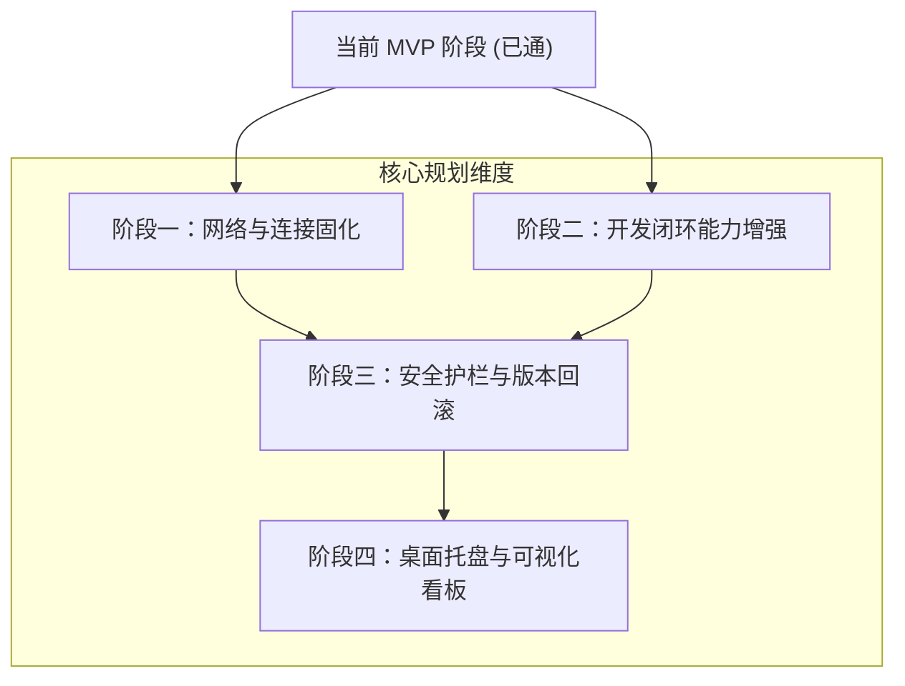
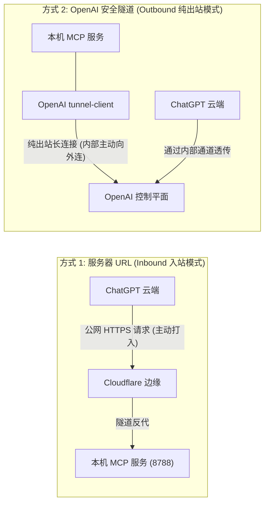

# 远程 Agent 本地开发 MCP 服务：产品落地方案与演进路线图

> 本文档记录了将当前 MCP 验证原型（MVP）打造为工业级、稳定易用的**“远程 AI 本地开发引擎”**的完整产品需求与架构设计。

---

## 一、产品愿景与定位

让开发者**无需自购云服务器、无需公网 IP**，即可让外部远程 AI Agent（如 ChatGPT Developer Mode、Claude、各类网页端/API Agent）安全受控地连接用户本机，完成真实的工程代码开发、调试与自动化工作流。

---

## 二、核心痛点与产品演进规划

### 1. 网络连接稳定性与固定入口
* **现状痛点**：当前 Cloudflare Quick Tunnel 每次启动生成随机临时子域名，每次重启都需要去 ChatGPT 重新改 URL，极其繁琐且不可靠。
* **规划方案**：
  * **方案 A（永久固定域名 - 推荐）**：支持绑定用户自己的域名接入 Cloudflare Named Tunnel（完全免费）。一次绑定，域名终身不变，无论电脑重启多少次，ChatGPT 中的连接器永久生效。
  * **方案 B（双通道自适应）**：局域网/本机直接走内网 IP；外网走固定隧道；未来支持挂载自建轻量 VPS 的 `frp` 或 `Caddy`。

### 2. 开发闭环能力（从单纯“改文件”到“完整开发”）
* **现状痛点**：目前外部 Agent 只能读写文件，无法运行测试或定位报错，处于“盲改代码”状态。
* **规划方案**：
  * **受控终端执行（Command Runner）**：提供安全的命令执行工具（如 `run_command`），允许 Agent 在项目根目录下执行 `npm test`、`pytest`、`python test.py`、`cargo check`、`git status` 等，改完代码即时自测。
  * **代码快速检索（Fast Code Search）**：集成类似 `ripgrep` 的关键字检索与符号查找，避免 Agent 盲目全量读文件消耗海量上下文 Token。
  * **Git 工作流协同**：原生集成 `git diff`、`git commit`、创建临时特性分支能力，Agent 的每次操作皆有迹可循。

### 3. 安全防御与人机协同边界（防范误操作）
* **现状痛点**：目前只要拥有 API Key，即可全量改写与删除已映射项目中的文件，无权限细分与撤销机制。
* **规划方案**：
  * **敏感凭据自动黑名单**：强行阻断 Agent 读取/篡改 `.env*`、`id_rsa`、`*.pem`、`.git/config`、各类含密码秘钥的文件。
  * **改动历史快照与一键回滚（Undo Ledger）**：Agent 在对任意文件执行写入/编辑前，本地自动保留影子副本。一旦 Agent 改错或破坏代码，开发者在本地可一键无损回滚。
  * **高危行为人机确认（Human-in-the-loop）**：可配置敏感动作（如删除文件、执行 `rm/del` 命令、大批量修改）时在电脑端弹出轻量通知/确认。

### 4. 产品形态与桌面交互体验
* **现状痛点**：目前依赖黑框终端窗口，容易误关闭，且增删项目映射需要手动编辑 YAML。
* **规划方案**：
  * **Windows 系统托盘常驻应用**：后台静默运行，托盘图标实时展示运行状态与当前活跃连接。
  * **轻量可视化管理面板（Local Admin UI）**：
    * 支持点击系统弹窗“选择文件夹”一键添加/删除本机项目映射。
    * 实时查看 Agent 正在调用哪个工具、读写了哪个文件的实时审计流日志。
    * 一键生成和复制不同客户端（ChatGPT、Cursor、Claude）的连接卡片。

---

## 三、ChatGPT 接入模式剖析：服务器 URL vs 官方安全隧道 (Tunnel)

在 ChatGPT 开发者模式的添加面板中，存在两种连接途径：

### 深度对比矩阵

| 对比维度 | 方式 1：服务器 URL (Server URL) | 方式 2：官方安全隧道 (OpenAI Tunnel) |
| :--- | :--- | :--- |
| **工作原理** | ChatGPT 作为客户端，从公网向你提供的 HTTPS 地址发起常规入站 HTTP 请求。 | 本地运行 OpenAI 官方的 `tunnel-client`，主动向 OpenAI 控制平面建立**纯出站**长连接。 |
| **公网暴露面** | **有公网入口**。需要通过 Cloudflare / ngrok 等工具将本地端口映射为一个公网 URL。 | **零公网暴露**。没有公网 URL，外界完全无法感知该服务，防火墙无需开放任何入站端口。 |
| **网络要求** | 本地需要能够连通隧道服务商（如 Cloudflare 边缘节点），容易受本地网络/代理环境影响。 | 只需要本机能够访问 OpenAI API（有常规代理即可畅通），不依赖第三方 DNS 映射。 |
| **配置门槛** | 简单直接：填入 URL 和 OAuth 信息即可连接，适合任意 MCP 客户端（不仅限于 ChatGPT）。 | 稍复杂：需要拥有 OpenAI 平台组织账号，并在控制台创建 `tunnel_id`，配置 API Key。 |
| **通用性与生态** | **高**。标准的 Streamable HTTP，不仅 ChatGPT，Cursor、Claude、自有远程服务均可共用。 | **仅限于 OpenAI**。专为 ChatGPT 生态内部私有服务定制。 |
