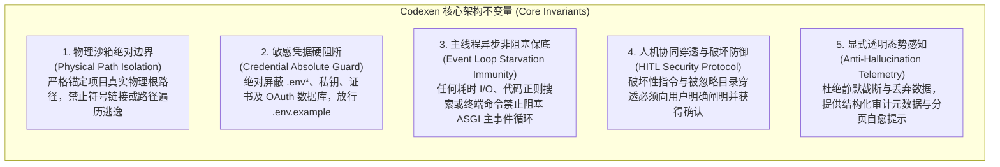

# Codexen 工程规格与架构演进文档库 📚
### Codexen Engineering Specifications & Architecture Evolution Library

欢迎查阅 **Codexen** 官方工程技术文档库。本目录是 Codexen 项目的正式架构规格书（RFC）、技术演进路线图（Roadmap）以及工程最佳实践规范的归档中枢。

---

## 🧭 文档库导航地图 (Documentation Index)

| 类别 / 阶段 | 文档入口 | 核心职责与说明 | 状态 |
| :--- | :--- | :--- | :--- |
| **基础规范** | 📄 **[DEPLOYMENT.md (完整部署与运维指南)](../DEPLOYMENT.md)** | 项目初始化、多模式网络穿透、OAuth 2.1 鉴权及配置字典 | **Living** |
| **架构演进** | 🗺️ **[evolution-roadmap.md (架构演进路线图)](evolution-roadmap.md)** | 涵盖 Phase 1 到 Phase 4 的分阶段能力交付规划与里程碑台账 | **Active** |
| **核心 RFC** | 📑 **[RFC 0001: 弹性异步事件循环、自适应规则分层与防幻觉态势感知](rfcs/0001-resilient-async-and-adaptive-search.md)** | 确立主事件循环非阻塞保底、项目 `.gitignore` 优先、HITL 穿透授权及防截断自愈协议 | **Accepted** |
| **开发计划** | 🧩 **[PLAN-0001: 统一 GitIgnore 忽略规则引擎](plans/0001-unified-gitignore-engine.md)** | Level 1/2/3 统一 gitignore 语法与匹配引擎、项目规则包合并与全局兜底触发条件 | **Delivered** |
| **主工程索引** | 🏠 **[README.md (项目主页)](../README.md)** | Codexen 项目定位、核心痛点解决、架构蓝图与 46+ 工具矩阵速查 | **Living** |

---

## 🏛️ Codexen 架构设计哲学与安全不变量 (Core Invariants)

在推进任何功能迭代、工具扩展或 Agent 交互时，Codexen 必须始终坚守以下五大不可逾越的底层架构不变量：

### 1. 物理沙箱绝对边界 (Physical Path Isolation)
* 所有的文件读取、写入、重命名、解压缩（防 Zip-Slip）与终端执行，必须严格锚定在当前操作的目标项目物理根路径之内。
* 严禁将 Codexen 引擎自身的安装或源码目录映射为对外可写目标项目，杜绝外部 Agent “修改宿主代码实现自我逃逸”。

### 2. 敏感凭据硬阻断 (Credential Absolute Guard)
* 涉及工作区内的 `.env*`（保护正式环境变量与本地 Token）、`id_rsa`、`*.pem`、`*.key`、`oauth_store.db` 等敏感机密，由底层安全过滤器强制短路拦截。
* 仅明确放行 `.env.example` 模板文件，以便 Agent 了解配置键名结构。

### 3. 主事件循环非阻塞保底 (Event Loop Starvation Immunity)
* Codexen 作为一个基于 `asyncio` + `FastMCP` + `Uvicorn` 的现代异步服务端，主线程事件循环必须专注于 HTTP 接入、SSE 流式通道维系、网络心跳保活与 Session 会话生命周期管理。
* 任何可能涉及深层磁盘 I/O（如代码全文检索 `search_code`）、大文件读写、或者外部终端进程等待的操作，必须强制委托至专用工作线程池（Worker Threads），坚决杜绝主事件循环饿死（Starvation）。

### 4. 人机协同穿透与破坏防御 (HITL Security Protocol)
* **高危系统级破坏命令**（`format`, `diskpart`, `reg`, `shutdown` 等）执行硬黑名单阻断；
* **敏感工程破坏命令**（`rmdir`, `git push`, `git reset --hard` 等）及**被忽略目录的穿透搜索**，必须触发人机协同（Human-in-the-Loop, HITL）机制。
* Agent 必须向用户明确阐明目标目录/操作的必要性，并由用户授权后传入 `confirmed=True` 与限定的白名单方可实施。

### 5. 显式透明态势感知与防截断自愈 (Anti-Hallucination Telemetry)
* 杜绝“静默丢弃文件”或“隐式尾部截断”。
* 当发生单文件过大跳过、超长单行截断或多页长文本读取时，工具必须返回详尽的结构化遥测审计数据（`search_audit`、`truncated: true`、`total_file_lines`），并提供明确的下一页调用提示（`hint`），从根源上消灭外部大模型的代码幻觉。

---

## 📜 RFC 规格演进流程 (RFC Process)

Codexen 的架构演进采用标准化 RFC（Request for Comments）机制进行规范化管理：

1. **提案草案 (Draft)**：提出针对核心架构、工具协议、安全护栏或通信层的重大变更设想，确立痛点与实施范围。
2. **审查评审 (Review)**：由维护者与核心开发者共同审查技术可行性、向下兼容性、多平台 Agent 行为影响及安全边界。
3. **正式采纳 (Accepted)**：设计决策获得批准，冻结接口数据契约与流程规范，作为标准规格书入库。
4. **落地交付 (Implemented)**：按计划完成代码编写、自动化单元测试与现网端到端验证。
5. **现行标准 (Living)**：随着 MCP 官方协议演进而持续维护与演进的基准技术规范。

---

> 💡 **参与贡献提示**：  
> 新增技术规格或调整现有工具契约前，请先阅读 [RFC 0001: 弹性异步事件循环、自适应规则分层与防幻觉态势感知](rfcs/0001-resilient-async-and-adaptive-search.md) 与 [evolution-roadmap.md](evolution-roadmap.md)，并在 `docs/rfcs/` 目录下按编号顺序提交新的 RFC 文档。
