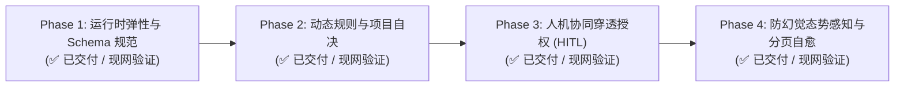

# Codexen 架构演进与能力交付路线图 🗺️
### Codexen Architecture Evolution & Capability Delivery Roadmap

本文档详细规划了 **Codexen** 桥接引擎的四个架构演进阶段，明确了各阶段的设计目标、技术要点、依赖变更与完成标准。

---

## 🧭 路线图概览 (Roadmap Overview)



| 阶段 | 核心主题 | 关键交付物 | 状态 | 目标版本 |
| :--- | :--- | :--- | :--- | :--- |
| **Phase 1** | **运行时弹性与 Schema 规范** | 异步非阻塞执行线程池、构建目录修剪、0 `anyOf` Schema 严格清洗 | **✅ 已交付** | v0.2.1 |
| **Phase 2** | **动态规则与项目自决** | 动态 `.gitignore` 引擎、项目规则最高权威、`permissions` 严格纯兜底 | **✅ 已交付** | v0.2.2 |
| **Phase 3** | **人机协同穿透授权 (HITL)** | `needs_confirmation` 协议、`authorized_paths` 局部/通配白名单 | **✅ 已交付** | v0.2.3 |
| **Phase 4** | **防幻觉态势感知与分页自愈** | `search_audit` 遥测审计、`read_file` 结构化截断元数据与自愈 `hint` | **✅ 已交付** | v0.2.4 |

---

## 📌 Phase 1: 运行时弹性与 Schema 规范 (Runtime Resilience & Schema Normalization)

> **目标**：彻底根除重型 I/O 阻塞主事件循环导致的假死事故，消除 Schema 中的歧义类型，确保各类云端 Agent 客户端稳定接入。

### 核心交付内容
1. **异步非阻塞执行保底**：
   - 在 `codexen/tools/__init__.py` 中引入 `_register_tool` 装饰器，基于 `anyio.to_thread.run_sync` 将所有 46 个工具调用派发至 Worker 线程池；
   - 彻底解放 ASGI / Uvicorn 主事件循环，任何文件 I/O、正则检索与终端命令执行均不再影响健康检查、网络心跳与新请求握手。
2. **构建目录基础修剪与防 DoS 检索**：
   - 在 `codexen/core/search.py` 中内置 `DEFAULT_SEARCH_IGNORED` 基线黑名单（`target`, `dist`, `build`, `.pnpm`, `*.lock` 等）；
   - 在 `codexen/core/fs.py` 中同步实现双重相对路径剪枝与单文件 2MB 大小跳过保护。
3. **Schema 严格清洗与归一化**：
   - 清理所有工具参数中的 `list[str] | None = None` 与 `str | None = None`；
   - 统一转为 `list[str] = []` 与 `str = ""`，彻底消除 FastMCP 导出的 `anyOf: [..., null]`，实现对 OpenAI / ChatGPT 严格模式的 100% 兼容。

### 验收与验证标准
* [x] 在包含 6,380+ 文件的 Tauri/Rust 混合工程中，`search_code` 检索耗时从 400+ 秒降至 21 毫秒（提速 18,000+ 倍）；
* [x] 110 项自动化单元测试全部通过（`test_async_search_concurrency.py` 验证并发无阻塞）；
* [x] 真实 MCP Streamable HTTP 客户端端到端校验通过。

---

## 📌 Phase 2: 动态规则与项目自决 (Dynamic Rules & Project Self-Determination)

> **目标**：终结中心化全局配置对不同技术栈工程的“一刀切”干预，确立项目级 `.gitignore` 为最高权威，全局配置严格作为无规则时的安全兜底。

### 核心交付内容
1. **动态 `.gitignore` 解析引擎集成**：
   - 引入高效的 GitIgnore 规则匹配库（如 `pathspec`）；
   - 动态扫描并缓存目标项目根目录及子目录下的 `.gitignore` 规则（支持按文件 mtime 自动失效刷新）；
   - 自动识别并尊重项目中自定义排除的目录（无论是 Rust 的 `target/`、Vue 的 `dist/`、Java 的 `target/` 还是任意专有缓存目录）。
2. **四级优先级生效机制**：
   - **Level 1 (最高)**：`项目级 .gitignore`（开发者的真实意图）；
   - **Level 2**：`config.yaml` 中的项目独立配置（`projects.<id>.ignored_patterns`）；
   - **Level 3**：全局 `permissions.ignored_patterns`（**严格仅在项目根目录与父级均无任何忽略规则时作为全局兜底**）；
   - **Level 4 (最低保底)**：系统安全防御基线（防系统驱动器或宿主根目录递归扫描）。
3. **定向读取与全量扫描职责解耦**：
   - `read_file` 允许定向读取命中 `.gitignore` 的常规文件（如调试打包结果），仅受沙箱边界与凭据黑名单限制；
   - `search_code` 与 `list_files` 遵循动态过滤规则。

### 验收与验证标准
* [x] 目标项目配置自身 `.gitignore` 后，全局 `config.yaml` 中的规则不产生覆盖或干扰；
* [x] 新建无任何 `.gitignore` 的空白项目时，全局 `permissions.ignored_patterns` 能有效兜底；
* [x] 新增 `tests/test_dynamic_gitignore_precedence.py` 专项测试，覆盖多级嵌套 `.gitignore`。

---

## 📌 Phase 3: 人机协同穿透授权 (HITL Penetration Authorization Protocol)

> **目标**：在保障系统安全和性能的前提下，赋予 Agent 在获得人类明确同意后穿透被忽略目录的灵活性，杜绝“全量失控”与“教条阻断”。

### 核心交付内容
1. **穿透探测与 `needs_confirmation` 拦截协议**：
   - 当 `search_code` 的目标路径 `subpath` 命中忽略规则，或者 Agent 请求跨越忽略边界时，工具拒绝静默执行，返回：
     ```json
     {
       "status": "needs_confirmation",
       "confirmation_type": "ignored_directory_penetration",
       "project": "meocox-vtube",
       "requested_subpath": "desktop/src-tauri/target",
       "message": "The directory is excluded by project .gitignore. You MUST ask the user in chat for confirmation. Once approved, re-call with confirmed=True and authorized_paths=['desktop/src-tauri/target']."
     }
     ```
2. **白名单受控放行机制**：
   - 新增参数 `authorized_paths: list[str] = []`；
   - 只有当 `confirmed=True` 且 `authorized_paths` 明确包含目标目录（或 `["*"]`）时，方才放行该目录的扫描。
3. **穿透审计与日志记录**：
   - 在 `.runtime/audit.log` 中记录 Agent 申请穿透的时间、目录、用户确认状态及扫描消耗。

### 验收与验证标准
* [x] Agent 未提供 `confirmed=True` 时试图扫描 `target/` 必定返回 `needs_confirmation`；
* [x] Agent 提供 `confirmed=True` 但 `authorized_paths` 不匹配时继续拒绝；
* [x] 授权放行后在目标目录下仍受到单文件 2MB 及 15 秒超时熔断保护；
* [x] 新增 `tests/test_hitl_penetration.py` 专项测试。

---

## 📌 Phase 4: 防幻觉态势感知与分页自愈 (Anti-Hallucination & Adaptive Pagination) - `✅ 已交付 (v0.2.4)`

> **目标**：杜绝一切静默行为，为云端大模型提供高保真的执行态势遥测与显式分页自愈提示，从根源上消灭大模型代码幻觉。

### 核心交付内容
1. **`read_file` 结构化截断与自愈 `hint`**：
   - 当读取文件超过 `max_read_chars` 或被行数限制时，绝不静默返回尾部残片；
   - 返回标准自愈结构：
     ```json
     {
       "status": "success",
       "truncated": true,
       "truncation_reason": "max_read_chars_limit_reached",
       "total_file_lines": 52000,
       "returned_start_line": 1,
       "returned_end_line": 2000,
       "next_start_line": 2001,
       "hint": "File truncated due to size limit. Call read_file(start_line=2001, end_line=4000) to read the next segment."
     }
     ```
2. **`search_code` 态势感知审计包 (`search_audit`)**：
   - 无论是否命中，返回结构中附带 `search_audit` 对象；
   - 列出跳过的大文件清单（含文件路径、大小、原因）、超长行安全截断警告（防止 ReDoS）、修剪的顶层目录清单；
   - 允许 Agent 根据审计信息向用户清晰解释“为什么某些文件未被扫描”。
3. **大文件体积阈值动态调优**：
   - 新增可选参数 `max_file_size_mb: int = 2`，允许 Agent 在获权场景下适度调大单文件阈值。

### 验收与验证标准
* [x] 针对 50,000 行超长文件调用 `read_file`，验证返回包含精确的 `next_start_line` 与调用 `hint`；
* [x] 针对含 3MB 文件的工程调用 `search_code`，验证 `search_audit.large_files_skipped` 正确记录该文件；
* [x] 新增 `tests/test_anti_hallucination_telemetry.py` 专项测试并通过 100% 验证。

---

## 📋 里程碑核验清单 (Milestone Checklist)

- [x] **2026-11-15: RFC 0001 正式立项入库**；
- [x] **Phase 1 全量功能交付与现网端到端验证完成**；
- [x] **Phase 2 动态 `.gitignore` 模块开发与单测覆盖**；
- [x] **Phase 3 HITL 穿透授权协议接入与前端/控制台联动**；
- [x] **Phase 4 防截断自愈与 `search_audit` 遥测全量上线**。
