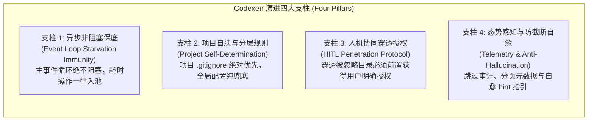
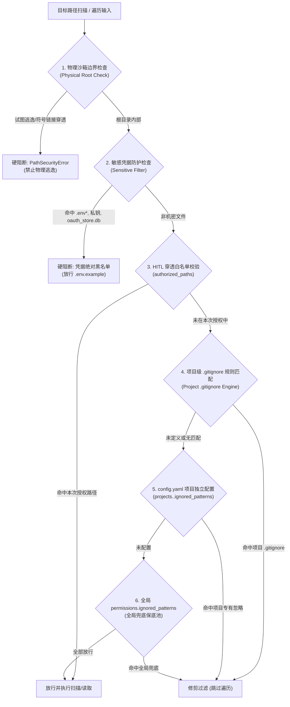
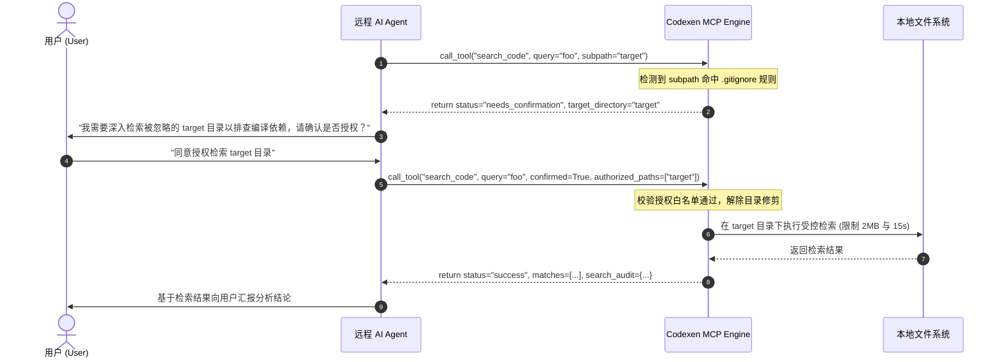
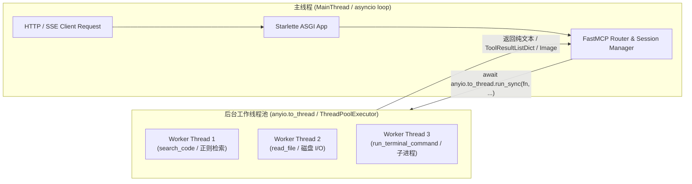

# RFC 0001: 弹性异步事件循环、自适应规则分层与防幻觉态势感知
### Resilient Async Event Loop, Adaptive Rules Layering, and Anti-Hallucination Telemetry

| 属性 | 内容 |
| :--- | :--- |
| **RFC 编号** | 0001 |
| **标题** | 弹性异步事件循环、自适应规则分层与防幻觉态势感知 |
| **作者** | Codexen Core Architecture Team |
| **提出日期** | 2026-11-15 |
| **当前状态** | **Accepted / Living** |
| **适用版本** | Codexen >= 0.2.0 |
| **关联文件** | `codexen/core/search.py`, `codexen/core/fs.py`, `codexen/core/gitignore.py`, `codexen/core/archive.py`, `codexen/tools/__init__.py`, `codexen/config.py` |

---

## 1. 摘要 (Summary)

本 RFC 确立了 Codexen 引擎在面对真实生产工程（如包含数千编译产物的 Tauri/Rust、大前端 MonoRepo、海量临时数据工程）时的核心健壮性、规则分层与大模型交互标准。

通过引入**主线程事件循环非阻塞解耦机制**、**项目级 `.gitignore` 动态优先原则**、**人机协同（HITL）忽略目录穿透授权协议**，以及**防截断大模型幻觉的显式态势感知元数据（Telemetry & Hint）**，从根本上解决系统假死、多项目规则冲突及云端 Agent 误改代码等严重可靠性痛点。

---

## 2. 背景与事故复盘 (Context & Incident Postmortem)

### 2.1 事故 1：MainThread 饿死引发假死（Event Loop Starvation）
* **现场现象**：在挂载多语言异构工程（如 `meocox-vtube` 包含桌面端、Tauri Rust 内核与前端）时，远程 Agent（如 ChatGPT）调用 `search_code` 进行代码检索，随后出现全盘超时。Agent 汇报：*“工具目录能列出，但执行端无法解析这些工具名称，连只读的代码搜索和 Git 状态查询都未能运行”*。
* **深层根因**：
  1. 官方 Python FastMCP 库底层在调度普通的同步函数（`def`）工具时，**直接在当前主线程的 asyncio 事件循环中同步执行**，未将其派发至线程池。
  2. 目标项目中包含 Tauri/Rust 编译生成的 `desktop/src-tauri/target` 目录（内含 6,380+ 个深层文件、大体积 `.d` 依赖文本与中间展开代码）。
  3. `search_code` 在同步主线程中对数千个文件进行递归扫描、打开与正则匹配，独占主线程达数百秒，导致 ASGI/Uvicorn 事件循环彻底饿死，连 `/health` 均超时无法响应。客户端在 HTTP 504 断开后，将超时与连接重置错误误读为“无法解析工具名称”。

### 2.2 事故 2：静态硬编码忽略的多项目不兼容（Static Ignored Conflicts）
* **现场现象**：Codexen 早期在全局配置中硬编码了固定 8 个忽略目录（`.git`, `.venv`, `node_modules` 等）。
* **深层根因**：
  现代技术栈高度多元化，Rust 生成 `target/`、前端生成 `dist/`、`.next/`、Java 生成 `target/`、Go 生成 `bin/`。单纯依赖中心化全局配置文件，无法预知所有工程的构建输出；而强制在全局配置中列出所有可能目录，又会剥夺目标工程自身的定义权威（如某个工具工程恰好需要分析 `target/` 下的构建结果）。

### 2.3 事故 3：静默截断与超长行引发的大模型幻觉（Silent Truncation & Hallucination）
* **现场现象**：
  - `read_file` 早期在超过 `max_read_chars`（100 万字符）时仅进行物理截断，未附带结构化分页指引；
  - `search_code` 对大文件或 minified 单行代码（数十万字符无换行）进行全盘正则搜索。
* **深层根因**：
  - 外部 Agent 接收到被静默截断的代码时，**会误认为文件末尾就是真实代码的终点**，从而得出“函数未闭合”、“类缺少实现”的荒谬判断，导致生成完全错误的补丁；
  - 对无换行的压缩 bundle 进行正则检索，极易引发灾难性回溯（ReDoS），瞬间耗尽 CPU。

---

## 3. 四大核心设计原则 (The Four Pillars)



### 3.1 原则 1：项目自决与四级分层规则 (Project Self-Determination & Tiered Rules)
Codexen 确立以**项目自身的 `.gitignore` 为最高权威**的四级判定流水线：



* **判定生效优先级**：
  $$\text{项目级 } .gitignore \gg \text{项目独立配置 } \text{projects.<id>.ignored} \gg \text{全局兜底 } \text{permissions.ignored\_patterns}$$
* **规则语义界定**：
  `permissions.ignored_patterns` **严格仅在项目根目录与父级均不存在任何有效 `.gitignore` 时，作为防止系统崩溃的兜底安全网生效**。一旦项目具备 `.gitignore`，全局规则自动退居次席，杜绝“主观预设破坏项目个性”。

### 3.2 原则 2：定向读取与全量扫描职责解耦 (Targeted Read vs. Broad Search Decoupling)
明确区分两种工具的职责与放行边界：
1. **`read_file`（定向探针）**：
   - 开发者或 Agent 明确知道具体相对路径（如查看 `dist/assets/index.css` 或 `target/debug/build.log`）时，**只要不触犯物理沙箱越界与敏感凭据黑名单，允许直接读取被忽略目录中的文件**；
   - 理由：定向读取单文件具有明确的坐标，I/O 确定且不会引发全盘风暴，严禁因路径命中 `.gitignore` 而教条化阻断正常排错。
2. **`search_code`（宽泛雷达）**：
   - 全盘递归检索必须严格遵守修剪规则，杜绝深层遍历构建目录。

### 3.3 原则 3：人机协同（HITL）穿透授权机制 (HITL Penetration Protocol)
当 Agent 明确需要深入被忽略目录（例如需要检索历史打包产物、依赖库源码 `node_modules` 或 `target` 符号）时：
- **禁止 Agent 擅自穿透**：工具端检测到查询目标全部位于忽略目录内，或显式要求跨忽略边界时，立即返回 `status="needs_confirmation"`；
- **结构化授权协议**：
  Agent 必须在对话中向人类用户列出目标路径与必要性。用户批准后，Agent 在下一次工具调用中传入 `confirmed=True` 与 `authorized_paths=["desktop/src-tauri/target"]`（或 `authorized_paths=["*"]` 全量授权），工具方予放行。



### 3.4 原则 4：透明态势感知与防截断自愈 (Telemetry & Anti-Hallucination Pagination)
消灭一切“静默行为”：
1. **`search_code` 态势感知元数据**：
   输出包含 `search_audit` 遥测包，明确记录耗时、跳过的大文件清单、截断行警告以及扫描文件总量。
2. **`read_file` 显式截断与自愈提示**：
   文件超限截断时，必须显式返回结构化切片字段（`truncated: true`, `next_start_line`, `hint`），Agent 能够直接根据 `hint` 发起下一页读取，彻底消除因截断导致的代码幻觉。

---

## 4. 接口契约与数据载荷规范 (Interface & Schema Specifications)

### 4.1 `search_code` 接口规格书

#### 参数定义 (Input Arguments)
| 参数名 | 类型 | 默认值 | 描述 |
| :--- | :--- | :--- | :--- |
| `project_id` | `str` | `""` | 目标配置项目 ID / 别名 |
| `query` | `str` | `""` | 检索关键词或正则表达式 |
| `subpath` | `str` | `""` | 限定检索的子相对路径 |
| `is_regex` | `bool` | `false` | 是否启用正则检索模式 |
| `case_sensitive` | `bool` | `false` | 是否大小写敏感 |
| `file_extensions` | `list[str]` | `[]` | 限定文件后缀列表（如 `[".py", ".ts"]`，严禁 `null` union） |
| `max_results` | `int` | `200` | 最多返回匹配数 |
| `max_file_size_mb` | `int` | `2` | 单文件检索上限（MB，默认 2MB） |
| `confirmed` | `bool` | `false` | HITL 确认标志 |
| `authorized_paths`| `list[str]` | `[]` | 本次用户明确授权穿透的目录路径白名单 |

#### 响应载荷 1：常规成功响应（含 Telemetry）
```json
{
  "status": "success",
  "project": "meocox-vtube",
  "query": "EventDispatcher",
  "is_regex": false,
  "files_scanned": 47,
  "total_matches": 2,
  "limit_reached": false,
  "timed_out": false,
  "duration_ms": 28.5,
  "matches": [
    {
      "file": "src/dispatcher.py",
      "line_number": 12,
      "line_content": "class EventDispatcher:",
      "match_span": [6, 21]
    }
  ],
  "search_audit": {
    "large_files_skipped": [
      {
        "file": "src/big_dump.txt",
        "size_bytes": 3145728,
        "size_mb": 3.0,
        "reason": "Exceeded max_file_size_mb limit (2MB)"
      }
    ],
    "truncated_lines_count": 0,
    "directories_pruned": [
      "desktop/src-tauri/target",
      "node_modules",
      "dist"
    ]
  }
}
```

#### 响应载荷 2：触发 HITL 确认请求
```json
{
  "status": "needs_confirmation",
  "confirmation_type": "ignored_directory_penetration",
  "project": "meocox-vtube",
  "requested_subpath": "desktop/src-tauri/target",
  "matched_rule_source": ".gitignore",
  "matched_pattern": "target/",
  "message": "The directory 'desktop/src-tauri/target' is excluded by project .gitignore. Penetrating ignored build directories may scan thousands of files and degrade performance. You MUST ask the user in chat for confirmation. Once the user approves, re-call search_code with confirmed=True and authorized_paths=['desktop/src-tauri/target']."
}
```

---

### 4.2 `read_file` 接口规格书

#### 参数定义 (Input Arguments)
| 参数名 | 类型 | 默认值 | 描述 |
| :--- | :--- | :--- | :--- |
| `project_id` | `str` | `""` | 目标配置项目 ID |
| `relative_path` | `str` | `""` | 相对文件路径 |
| `start_line` | `int` | `0` | 起始行号（从 1 起算，0 表示从头开始） |
| `end_line` | `int` | `0` | 截止行号（包含本行，0 表示读至末尾） |
| `offset` | `int` | `0` | 字符偏移起始量 |
| `limit` | `int` | `0` | 读取字符数上限 |
| `encoding` | `str` | `"utf-8"`| 文件编码 |

#### 响应载荷：发生安全截断时的自愈响应
```json
{
  "status": "success",
  "project": "meocox-vtube",
  "relative_path": "backend/large_service.py",
  "encoding": "utf-8",
  "content": "import sys\n...\n# [CONTENT OF LINES 1 TO 2000]",
  "truncated": true,
  "truncation_reason": "max_read_chars_limit_reached",
  "total_file_lines": 52000,
  "returned_start_line": 1,
  "returned_end_line": 2000,
  "returned_chars": 85000,
  "next_start_line": 2001,
  "next_offset": 85001,
  "hint": "File truncated due to size limit. Call read_file(project_id='meocox-vtube', relative_path='backend/large_service.py', start_line=2001, end_line=4000) to read the next segment."
}
```

---

## 5. 架构实现与线程模型 (Architecture & Threading Model)

Codexen 引擎必须在网络主宿主与底层工具执行之间实现**两级隔离**：



1. **装饰器级别强制入池**：
   在 `codexen/tools/__init__.py` 中，所有 `@_register_tool()` 注册的工具函数必须被自动包装为异步协程，内部通过 `await anyio.to_thread.run_sync(...)` 委派给工作线程。
2. **零副作用向下兼容**：
   工具函数本身保持原有同步函数签名，以便内部单元测试直接同步执行，而在 FastMCP 内省层暴露为 `is_async: True`。

---

## 6. 安全沙箱与不变量保障 (Security Invariants)

1. **拒绝物理逃逸**：
   所有相对路径在拼接后必须通过 `safe_resolve_path` 进行真实物理路径解析，并验证 `project.root in resolved_path.parents`。凡包含 `..`、非法符号链接或 Windows 设备文件（`NUL`, `CON`, `COM1`）的操作，一律直接阻断。
2. **凭据绝对免疫**：
   无论是否传入 `confirmed=True`，`.env*`（`.env.example` 除外）、私钥及 `oauth_store.db` 属于**绝对硬阻断范畴**，严禁以任何理由放行。

---

## 7. 实施与验证状态 (Implementation & Verification Status)

* [x] **Phase 1（运行时弹性底座与 Schema 规范）**：
  - [x] 工具执行全面异步入池，事件循环饿死防御完毕；
  - [x] `search_code` 基础大文件与 `DEFAULT_SEARCH_IGNORED` 基线构建目录修剪完毕；
  - [x] 46 个工具 Schema 严格归一化（0 `anyOf` / `null` 歧义）；
  - [x] 全量自动化测试 100% 绿灯通过。
* [x] **Phase 2（动态规则与项目自决）**：
  - [x] 零外部依赖动态 `.gitignore` 引擎实现，支持否定排除（`!`）、通配符与根/子目录继承；
  - [x] 四级规则流水线落地：项目自身 `.gitignore` 拥有最高权威，全局配置严格纯兜底；
  - [x] `.gitignore` 文件修改基于 `mtime` 秒级热重载与缓存自愈。
* [x] **Phase 3（HITL 穿透协议与遥测审计）**：
  - [x] 拦截未经授权的被忽略目录穿透尝试，返回标准 `needs_confirmation` 结构体；
  - [x] 完整支持 `confirmed=True` 与 `authorized_paths` 局部白名单放行；
  - [x] 穿透操作在 `.runtime/audit.log` 中记录审计轨迹，Level 4 核心凭证与内部版本库硬阻断。
* [x] **Phase 4（防幻觉遥测与分页自愈）**：
  - [x] `search_code` 返回结构化 `search_audit`（大文件跳过、超长行截断计数、修剪目录）；
  - [x] `read_file` 截断时提供 `next_start_line` 与即用型自愈调用 `hint`；
  - [x] `search_code` 匹配行提供 `line_truncated` 与 `line_full_length`，支持 `max_file_size_mb` 动态安全调优。
