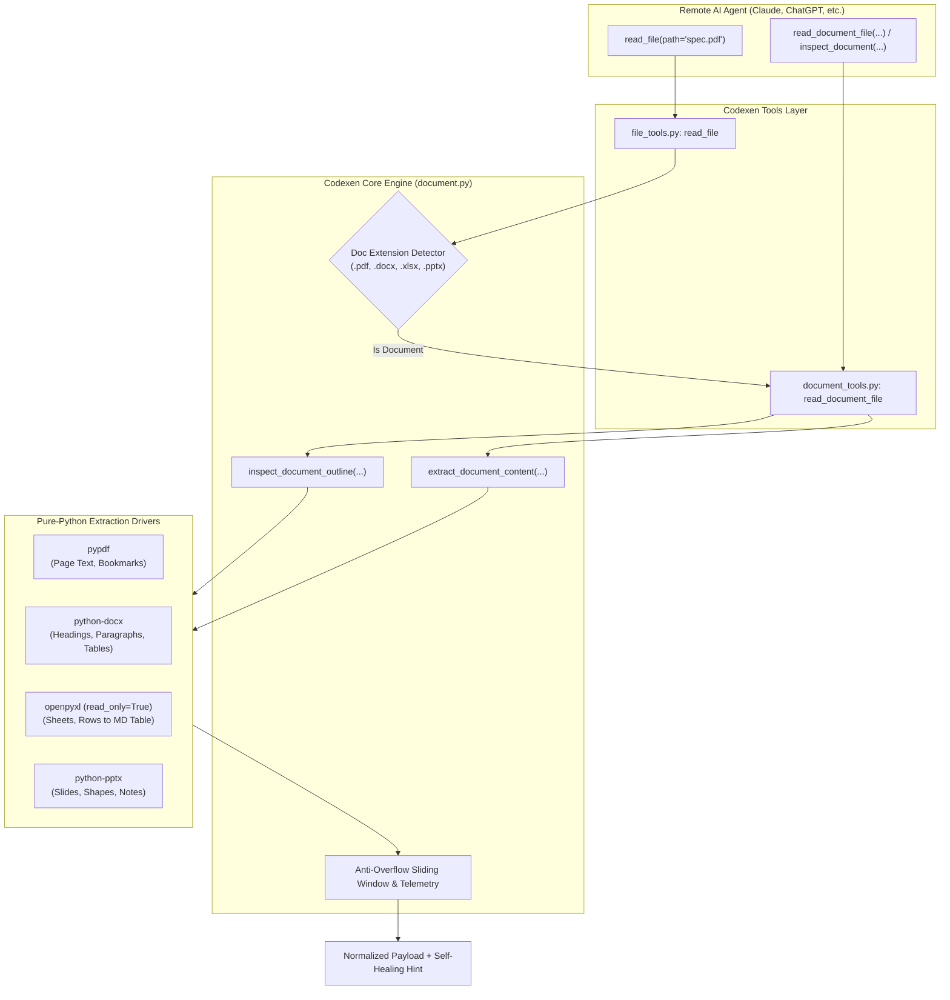

# RFC 0002: 通用文档智能解析引擎与防溢出分段自愈协议
### Universal Document Extraction Engine and Anti-Overflow Chunked Healing Protocol

| 属性 | 内容 |
| :--- | :--- |
| **RFC 编号** | 0002 |
| **标题** | 通用文档智能解析引擎与防溢出分段自愈协议 |
| **作者** | Codexen Architecture & Agent Tooling Group |
| **提出日期** | 2026-11-16 |
| **当前状态** | **Approved by Interview / Ready for Implementation** |
| **适用版本** | Codexen >= 0.4.0 |
| **关联模块** | `codexen/core/document.py`, `codexen/tools/document_tools.py`, `codexen/tools/file_tools.py`, `codexen/tools/__init__.py`, `pyproject.toml` |

---

## 1. 摘要 (Summary)

本 RFC 规划并确立了 Codexen 下一阶段核心能力演进——**通用非纯文本工程文档解析引擎**。该能力覆盖 **DOCX、PDF、XLSX、PPTX** 四大主流文档格式，旨在打破纯文本代码与富文本业务资产（技术规范、架构图讲稿、测试用例表、接口文档）之间的信息壁垒。

经深度推演，本规范确立了以下核心架构原则：
1. **独立通用文档工具 + `read_file` 透明兜底路由**：提供专门的 `read_document_file` 工具（及 `read_document` 别名），当 `read_file` 误收文档路径时静默路由到文档引擎，保障单次调用立即成功，并在响应及工具描述中引导 Agent 使用专项工具；
2. **LLM 友好 Markdown 与原生文本双模提取**：默认将表格转化为 Markdown 表格、标题转为 `#`、明确分页/幻灯片/工作表分界；同时支持 `format='raw'`（或 `raw: bool`）提取原始文本，遇到复杂解析边缘时具备自动平滑降级能力；
3. **双轨制物理/语义精细分页**：针对 PDF（页码）、PPTX（幻灯片）、XLSX（Sheet 与行窗口）、DOCX（段落/章节），同时暴露通用 `page` / `page_size` 与精细化参数（`start_page`, `end_page`, `sheet_name`, `start_row`, `max_rows`, `start_slide`, `end_slide`）；
4. **轻量纯 Python 依赖标配化**：引入 `pypdf`, `python-docx`, `openpyxl`, `python-pptx` 作为核心内置依赖，实现零外部 C/二进制依赖（免除 Poppler/Office/LibreOffice 运行时锁绑定），开箱即用；
5. **大文件防幻觉自愈元数据（Anti-Hallucination Telemetry）**：未指定分页参数读取大文档时，默认静默自动分页（返回前 N 页/行），绝不抛错阻断，并在响应中回传 `total_pages`、`next_page` 及高保真自愈 `hint`；
6. **大纲结构极速探测**：内置 `outline_only=True` 模式并注册 `inspect_document` 别名工具，毫秒级读取工作表列表、PDF 书签目录与演示文稿大纲。

---

## 2. 动机与背景 (Motivation & Background)

在真实的远程开发与协同场景中，软件仓库不仅包含 `.py`, `.ts`, `.rs` 代码文件，还广泛沉淀了以下关键资产：
* **架构与设计说明**：`.pdf` 或 `.docx` 格式的产品需求文档（PRD）与系统设计说明书；
* **业务数据与测试用例**：`.xlsx` 格式的接口映射矩阵、数据字典与压测结果报表；
* **技术宣讲与汇报讲稿**：`.pptx` 格式的系统架构演讲稿与技术选型方案。

### 现状缺陷
1. **读取即乱码/报错**：当前 `read_file` 仅支持纯文本文件解码（UTF-8 等）。若 Agent 尝试读取上述文件，会导致 UTF-8 解码失败，或读出充满二进制空字节 `\x00` 的乱码；
2. **`read_binary_file` 仅返回 Base64**：现有二进制工具将整个文件 Base64 编码并计算哈希，远程 LLM 无法直接阅读上百 KB 乃至数十 MB 的 Base64 字符串；
3. **上下文溢出风险（Context Bomb）**：动辄上百页的 PDF 或几万行的 Excel 表格，若一次性提取成文本返回，将瞬间打爆大模型上下文窗口（400k+ tokens），造成高昂 Token 浪费甚至触发客户端熔断。

---

## 3. 详细架构设计 (Detailed Architecture)



---

## 4. MCP 工具定义规范 (Tool Contract Specification)

### 4.1 主工具：`read_document_file` (别名 `read_document`)

```python
def read_document_file(
    project_id: str = "",
    project_name: str = "",
    relative_path: str = "",
    path: str = "",
    # --- 通用分页控制 ---
    page: int = 1,
    page_count: int = 10,
    max_chars: int = 50_000,
    # --- 格式专有精细控制 ---
    start_page: int = 0,
    end_page: int = 0,
    sheet_name: str = "",
    start_row: int = 0,
    max_rows: int = 100,
    start_slide: int = 0,
    end_slide: int = 0,
    # --- 输出模式与控制 ---
    format: str = "markdown",       # "markdown" | "raw"
    outline_only: bool = False,     # 仅提取结构大纲/工作表清单
    auto_paginate: bool = True,     # 默认开启防溢出自愈截断
) -> dict[str, Any]:
    ...
```

### 4.2 别名工具：`inspect_document` (别名 `inspect_document_file`)
元编程映射到 `read_document_file(..., outline_only=True)`，专注返回：
* 整体页数 / 幻灯片总数 / 工作表清单（含各 Sheet 有效行列数）；
* PDF 目录树 / DOCX 章节标题大纲；
* 核心元数据（标题、作者、创建时间）。

### 4.3 现有 `read_file` 的透明路由协议
在 `codexen/tools/file_tools.py:read_file` 接收到调用时：
1. 检查文件扩展名，若处于 `{'.pdf', '.docx', '.xlsx', '.pptx'}`；
2. **静默转派**：直接在底层调用 `extract_document_content(...)`，以默认自适应分页提取首段内容；
3. **返回附带引导**：在返回的字典中附带 `hint`：
   > *"Notice: 'spec.pdf' is a rich document file. Codexen transparently extracted the first 10 pages for you. For advanced pagination, sheet selection, or slide slicing, please call the dedicated 'read_document_file' (or 'inspect_document') tool."*

---

## 5. 四大格式解析与降级机制 (Format Adapters & Fallback)

### 5.1 PDF (`pypdf`)
* **页码定位**：基于 0-indexed 物理页，通过 `reader.pages[i]` 严格切片，内存开销为 O(1) 单页流式；
* **大纲提取**：解析 `reader.outline`，递归构建层级目录结构；
* **扫描件防呆**：若全页提取字符数为空或低于 10 个字符，标记 `warning: "Document appears to be a scanned image with no text layer. Text extraction cannot extract scanned pixels."`。

### 5.2 DOCX (`python-docx`)
* **排版转换**：`Heading 1` -> `#`，`Heading 2` -> `##`，表格转为标准 GitHub Flavored Markdown 表格；
* **分段逻辑**：支持按段落计数（`start_paragraph`, `max_paragraphs`）与标题章节分块；
* **降级保护**：若复杂 XML 节点解析异常，降级为纯文本流 `\n`.join(p.text)。

### 5.3 XLSX (`openpyxl`)
* **流式只读**：强制开启 `load_workbook(filename, read_only=True, data_only=True)`，杜绝万行大表占用数百 MB 内存；
* **工作表自适应**：未指定 `sheet_name` 时默认读取第一个活跃 Sheet，同时元数据列出全部可选 Sheet；
* **行切片与 Markdown 表格化**：按 `start_row` 至 `start_row + max_rows` 生成 Markdown 表格，空行智能跳过，防止巨量空单元格污染。

### 5.4 PPTX (`python-pptx`)
* **幻灯片切片**：按 `start_slide` 至 `end_slide` 提取；
* **元素重组**：标明 `### Slide N: [Title]`，依次提取文本框、形状要点；
* **演讲者备注**：若幻灯片包含 `slide.notes_slide`，在末尾附带 `> 📝 Speaker Notes: ...`。

---

## 6. 防大模型幻觉自愈响应格式 (Anti-Hallucination Telemetry)

当返回内容触发截断时，返回高保真结构化 Payload：

```json
{
  "status": "success",
  "project": "core-backend",
  "relative_path": "docs/architecture_spec.pdf",
  "format": "markdown",
  "document_type": "pdf",
  "total_pages": 48,
  "returned_start_page": 1,
  "returned_end_page": 10,
  "returned_chars": 14250,
  "truncated": true,
  "truncation_reason": "default_page_limit_reached",
  "content": "# Architecture Specification\n\n--- Page 1 / 48 ---\n...",
  "available_sheets": [],
  "has_more": true,
  "next_page": 11,
  "hint": "Document truncated: Showing pages 1-10 of 48. Call read_document_file(project_id='core-backend', relative_path='docs/architecture_spec.pdf', start_page=11, end_page=20) to read the next segment."
}
```

---

## 7. 实施落地步骤 (Implementation Plan)

1. **依赖升级**：在 `pyproject.toml` 的 `dependencies` 中添加 `pypdf>=5.0.0`, `python-docx>=1.1.0`, `openpyxl>=3.1.2`, `python-pptx>=1.0.0`；
2. **核心层开发**：创建 `codexen/core/document.py`，实现格式分发、大纲探测、Markdown 转换及分页切片引擎；
3. **工具层封装**：创建 `codexen/tools/document_tools.py`，注册 `read_document_file`, `read_document`, `inspect_document`；并在 `codexen/tools/__init__.py` 中接入；
4. **`read_file` 路由接入**：在 `codexen/tools/file_tools.py` 中补充文档类型路由分流；
5. **单元测试与集成测试**：在 `tests/test_document_tools.py` 中覆盖 4 种格式的真实二进制解析、大纲探测、分页截断与错误降级。
