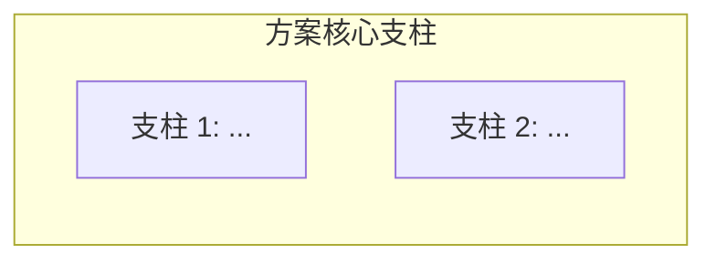
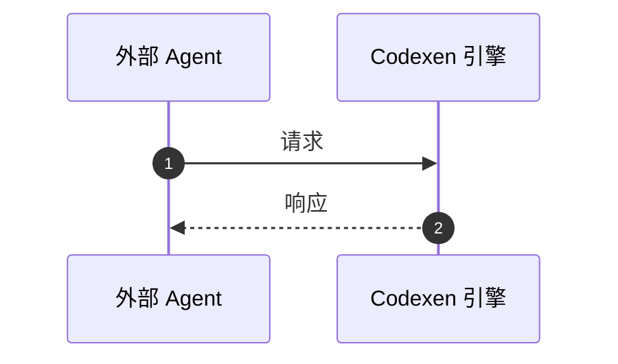

# RFC [编号]: [简短标题]
### [English Subtitle / Brief Description]

| 属性 | 内容 |
| :--- | :--- |
| **RFC 编号** | [如 0002] |
| **标题** | [技术规格完整名称] |
| **作者** | [作者姓名 / 团队] |
| **提出日期** | YYYY-MM-DD |
| **当前状态** | **Draft / In Review / Accepted / Implemented / Living** |
| **适用版本** | Codexen >= X.Y.Z |
| **关联文件** | `codexen/xxx.py`, `tests/test_xxx.py` |

---

## 1. 摘要 (Summary)

[用 2-3 段精炼的语言概括本 RFC 解决的核心痛点、提出的技术机制以及预期带来的系统收益。]

---

## 2. 背景与事故复盘 (Context & Incident Postmortem)

[阐述促成该提案的现实背景、现有实现的局限性或在线上遭遇的实际事故复盘。建议按事故场景展开：]

### 2.1 现状与痛点
* **现场现象**：...
* **深层根因**：...

### 2.2 影响范围
* ...

---

## 3. 核心设计原则 (Design Principles / Pillars)

[列出方案必须坚守的设计原则与架构支柱（如非阻塞保底、规则最高权威等）。可附带核心设计原则架构图：]



---

## 4. 详细技术方案与数据契约 (Detailed Technical Design)

### 4.1 核心流程与时序图


### 4.2 接口 / 数据契约变更
* **输入参数变化**：
  ```python
  def example_tool(param: str = "") -> dict:
      pass
  ```
* **返回格式定义**：
  ```json
  {
    "status": "success",
    "data": {}
  }
  ```

### 4.3 核心算法与匹配逻辑
* ...

---

## 5. 安全考量与影响分析 (Security & Invariants Impact)

* **物理沙箱影响**：[是否涉及文件系统跨目录访问？]
* **凭据与鉴权保护**：[是否可能触碰敏感凭据或配置？]
* **主事件循环健康度**：[是否包含重型 I/O 或耗时计算？如何确保非阻塞？]
* **向下兼容性分析**：[现有客户端是否会被破坏？]

---

## 6. 验证与验收用例 (Verification & Acceptance Test Cases)

列出方案落地后必须通过的自动化单元测试与端到端验收场景：

* [ ] **用例 1**：...
* [ ] **用例 2**：...

```bash
uv run --frozen python -m unittest discover tests -v
```

---

## 7. 备选方案与未决问题 (Alternatives & Open Questions)

### 7.1 曾考虑过的替代方案及否决原因
* **备选方案 A**：... 否决理由：...
* **备选方案 B**：... 否决理由：...

### 7.2 当前未决问题 (Open Questions)
* ...
