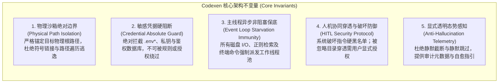
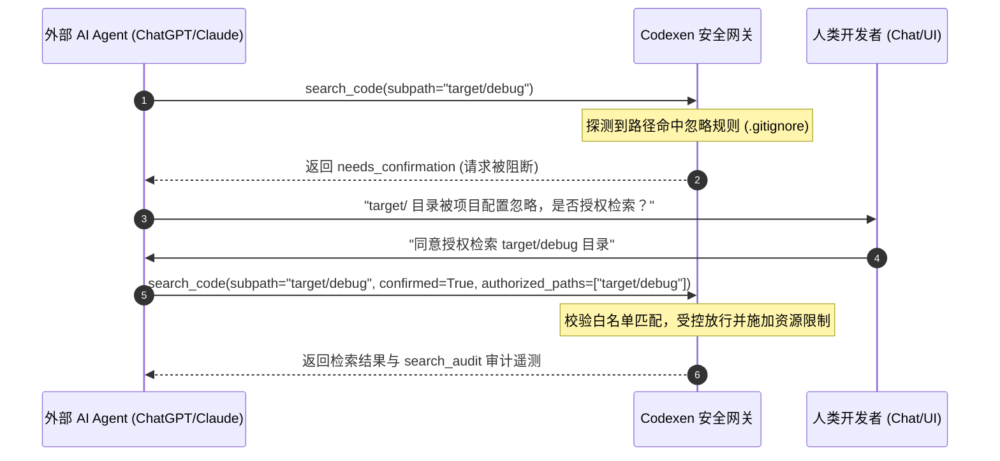

# Codexen 核心架构与安全不变量规范 🛡️
### Codexen Core Architectural & Security Invariants

在构建、扩展或与 AI Agent 协作推进 **Codexen** 桥接引擎时，本规范所列出的 **五大安全防御不变量（Core Invariants）** 具有不可逾越的最高约束力。任何业务优化、性能改动或自动化工具实现，均不得以牺牲或绕过底层安全边界为代价。

---

## 🏛️ 五大核心架构不变量 (The Five Invariants)

---

## 1. 物理沙箱绝对边界 (Physical Path Isolation)

* **绝对锚定真实物理根路径**：所有的文件读取、写入、移动、解压缩（防 Zip-Slip 攻击）与目录遍历，必须在解析真实符号链接（`Path.resolve()`）后，严格验证其物理路径位于当前目标项目的根路径之内。
* **反宿主注入防御**：严禁将 Codexen 引擎自身的安装目录或源码仓库暴露为可写目标项目，彻底杜绝外部 Agent 通过“修改宿主服务代码实现自我逃逸与恶意常驻”。
* **违规处理**：一旦探测到路径越界或非法相对引用（如 `../../windows/system32`），底层安全层直接抛出 `PathSecurityError` 阻断执行。

---

## 2. 敏感凭据硬阻断 (Credential Absolute Guard)

* **绝对阻断黑名单清单**：
  - 本地环境变量与配置文件：`.env`, `.env.*`（如 `.env.local`, `.env.production`）；
  - 私钥与证书文件：`id_rsa`, `id_ed25519`, `*.pem`, `*.key`, `*.pfx`, `*.keystore`；
  - 运行时敏感数据源：`oauth_store.db`, `.git/` 核心版本库元数据目录；
* **仅有的合法放行例外**：
  - 仅明确放行 **`.env.example`** 模板文件，以便外部大模型或 Agent 学习环境变量键名定义与结构；
* **不可绕过性**：
  - 凭据黑名单独立于 `.gitignore`，**严禁**通过 `.gitignore` 中的否定规则（`!/.env`）取消忽略；
  - 凭据黑名单独立于人机协同协议，**严禁**通过 `confirmed=True` 或 `authorized_paths` 绕过阻断。

---

## 3. 主事件循环非阻塞保底 (Event Loop Starvation Immunity)

* **ASGI / Uvicorn 主线程生命线保护**：
  - Codexen 作为一个基于 `asyncio` + `FastMCP` 的异步服务端，主线程事件循环负责承载 HTTP 接入、SSE 流式长连接握手、心跳保活与状态探活；
  - 任何耗时磁盘 I/O（如深层文件树遍历、大文件分块读写）、CPU 密集型正则搜索（`search_code`）或外部终端等待，**严禁**在主线程事件循环中同步执行。
* **线程池解耦机制**：
  - 所有的工具方法必须由底座框架基于 `anyio.to_thread.run_sync` 委托给专用的 Worker 线程池异步执行；
  - 即使正在对数千个源文件进行代码检索，服务器依然能毫秒级响应外部系统的 `/health` 探针与新请求握手。

---

## 4. 人机协同穿透与破坏防御 (HITL Security Protocol)

* **系统级高危破坏指令硬阻断**：
  - 对危险系统命令（`format`, `diskpart`, `shutdown`, `reg` 等）直接实施硬性执行拦截；
* **敏感工程破坏命令人机确认**：
  - 对不可逆的工程破坏指令（如 `git reset --hard`, `git push --force`, `rmdir /s`），工具绝不直接静默执行，必须返回 `needs_confirmation` 拦截结构；
* **忽略目录穿透保护**：
  - 当搜索或目录遍历跨越 `.gitignore` 规则边界时，工具必须返回结构化拦截信息，指导 Agent 向人类用户发起对话确认；
  - 只有在同时满足 `confirmed=True` 且 `authorized_paths` 精确命中目标路径时，方才受控放行。

---

## 5. 显式透明态势感知与防截断自愈 (Anti-Hallucination Telemetry)

* **杜绝隐式截断**：
  - 当单行代码过长、文件体积超出限制、或匹配结果达到安全上限时，绝不静默丢弃后续内容或返回残缺尾部；
* **结构化分页自愈提示**：
  - `read_file` 发生截断时，必须随返回值提供明确的自愈元数据（`truncated: true`、`total_file_lines`、`next_start_line` 及供 Agent 下一次直接调用的 `hint` 参数建议）；
* **检索审计信息 (`search_audit`)**：
  - `search_code` 必须返回完整的遥测审计包，明列跳过的大文件列表、超长单行截断警告与修剪的目录，使 Agent 能够向用户清晰解释“未检索到代码的原因”。
